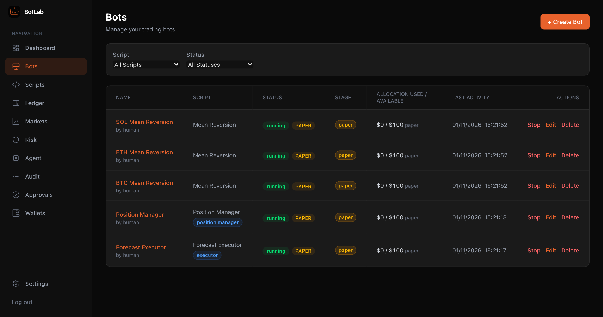
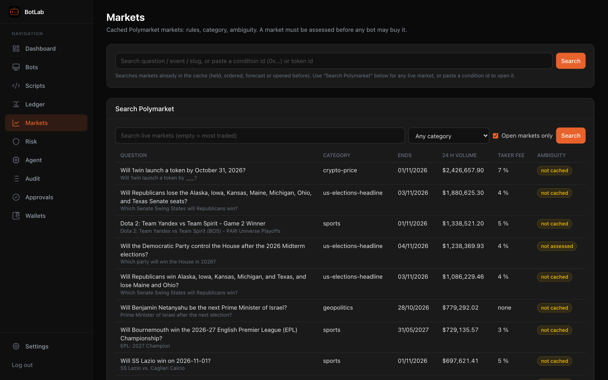
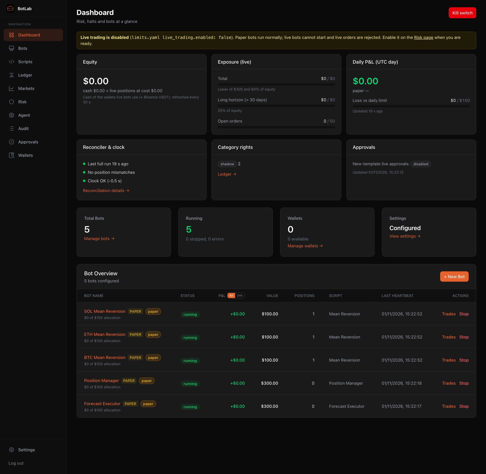

# BotLab

Self-hosted trading lab for **Polymarket** prediction markets (and **Binance** spot). Bots are TypeScript
scripts that run in sandboxed worker threads; every order goes through a server-side **risk engine**
with human-set hard limits. One Node server holds the database, the bots and the risk controls; you use
it from a browser, and an optional **Claude agent** researches markets and runs paper bots through MCP.

Runs natively on **macOS, Windows and Linux** (Node 22), or in **Docker** on a home server.



## A glimpse

Screenshots from a fresh install with the default config: paper bots only, real market data, no exchange
credentials. More in the [guides](#guides).

**Every order goes through the risk engine**, paper ones too. This bot's take-profit sells were refused
because the position was younger than the 30-minute minimum hold:


**Write bots in the browser** with typings for the whole `ctx` API, or start from a template. **Search live
Polymarket markets** with their category, fees and ambiguity score:

| Script editor | Live Polymarket search |
|---|---|
|  |  |

**Talk to the agent** in Claude Code or Claude Desktop. BotLab is an MCP server; the agent researches,
assesses markets, writes forecasts and runs paper bots, but can never change limits, wallets or credentials.
A real session (rendered from its transcript), where the server refused forecasts on thinly traded markets:


**The dashboard**: kill switch, exposure, daily P&L, reconciliation and every bot at a glance.



## Quick start

You need **Node.js 22** (22.12 or newer, not 25+) and git. Nothing else to start: a fresh install runs
**paper bots only**.

```bash
git clone <repo-url> botlab && cd botlab
npm install
npm run dev          # then open http://localhost:3000
```

Choose an **admin password** on the first-run screen, then create a bot from a template. Production mode,
Docker, the Windows service, the master key and Node version details are in [Install and run](docs/guide/install.md).

## How it stays safe

- **Paper first.** New bots are paper bots (simulated balance, real market data). Live trading is off until
  you switch it on in `limits.yaml` and add a wallet.
- **One choke point for orders.** Every order, from every bot, passes the risk engine: exposure, loss limits,
  order size, hold time, liquidity and spread, the ramp from paper to full allocation, and a kill switch.
- **Limits are yours.** Limits, mandate, categories and fees are YAML files only a human can change (validated,
  with history and restore). The agent can read them, never write them.
- **Secrets stay in the server.** Wallet keys and Binance credentials are encrypted with a master key and never
  sent to the browser. Bind to localhost or Tailscale; never expose BotLab to the internet.

## Guides

| Guide | What's in it |
|---|---|
| [Install and run](docs/guide/install.md) | Node 22, dev and production mode, data dirs, Docker, master key, upgrading, Windows service, hosting on a VPS |
| [Operating BotLab](docs/guide/operations.md) | First run and going live, limits, dashboard, environment variables, access and API tokens, security |
| [Bots and scripts](docs/guide/scripting.md) | How bots run, writing scripts, the `ctx` API reference, config schemas, built-in templates |
| [Strategies](docs/guide/strategies.md) | Markets and the forecast ledger, Forecast Executor, Position Manager, Consistency, Resolution Rule, Copy Trading |
| [The AI agent](docs/guide/agent.md) | Talking to the agent, MCP setup for Claude Code / Desktop, tools, the scheduled agent |
| [Development](docs/guide/development.md) | Commands and repository layout |

## Disclaimer

Trading involves substantial risk of loss. The authors are not responsible for any financial losses or damages resulting from the use of this software. Use at your own risk.

## License

ISC
