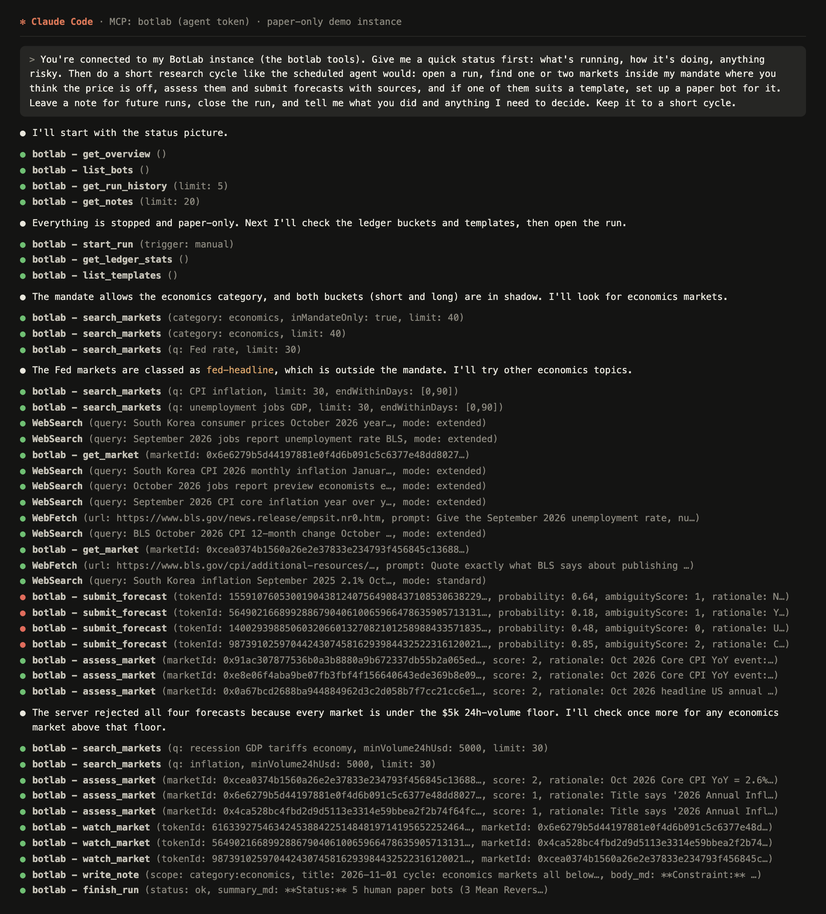
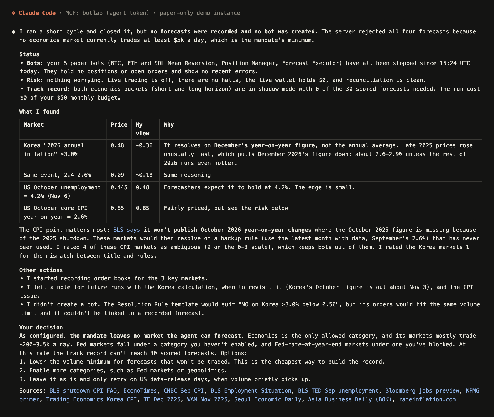
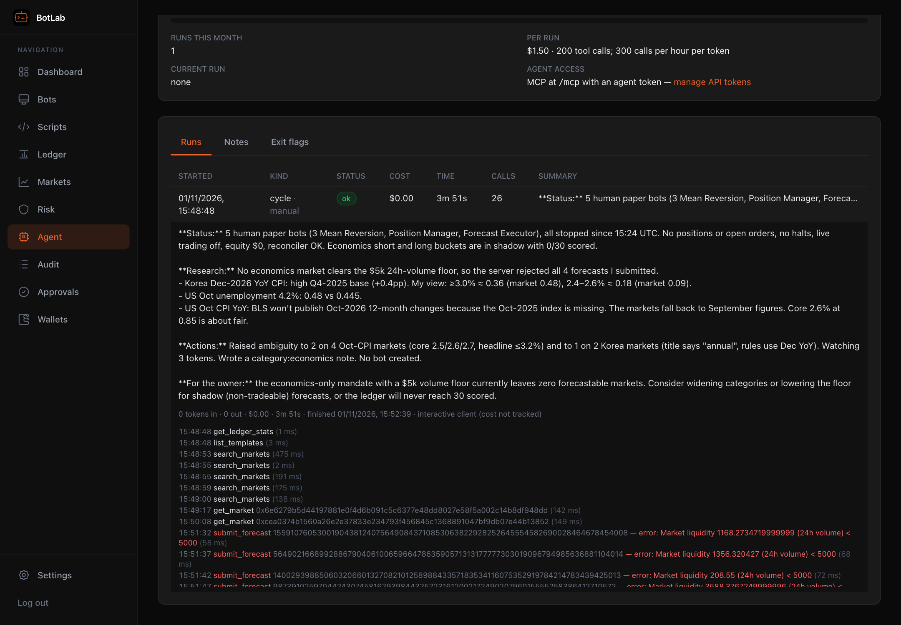
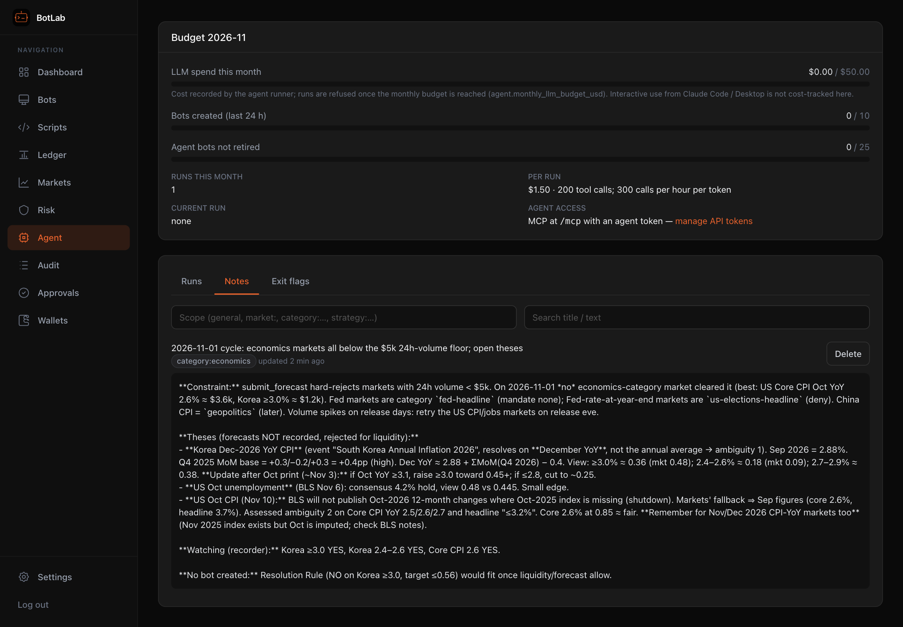
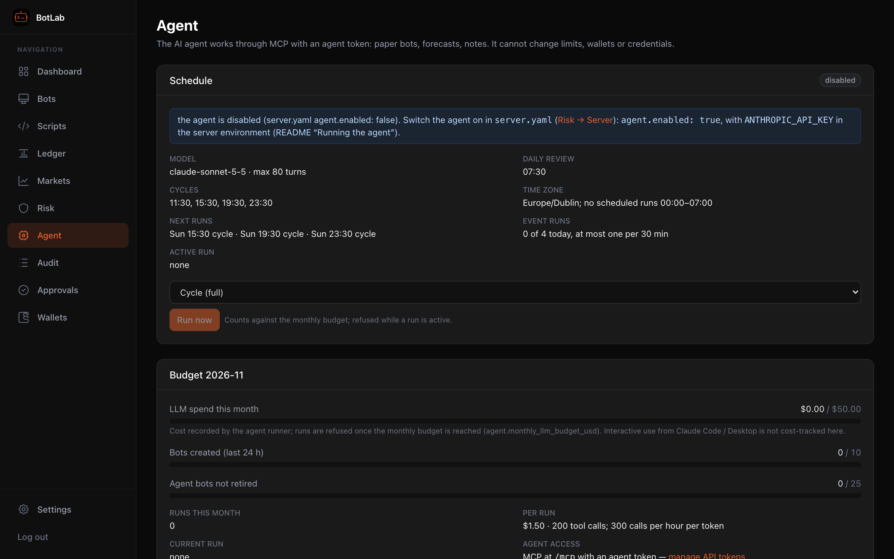

[← BotLab README](../../README.md)

# The AI agent

## Talk to the agent in Claude Code or Claude Desktop

BotLab is an MCP server. Connect Claude Code or Claude Desktop to `/mcp` with an agent token
([setup](#mcp-server-ai-agent)) and you converse with the agent directly: ask for a status, have it research
markets, assess their rules, submit forecasts, build and backtest templates, or run paper bots. It works as
the **agent**: paper bots only, only bots it created, every call audited, and it can never change limits,
the mandate, wallets or credentials.

This is a real session against a paper-only demo instance with the default config (rendered from the recorded transcript). One request
asked for a status check and a short research cycle:



The red calls are the server saying no: all four forecasts were refused because the markets trade less than
the mandate's $5k a day. The agent then rated the CPI markets as ambiguous (it found that BLS won't publish
the October year-on-year figure, so they would resolve on a fallback rule), started recording their order books, left a note
and handed the mandate question back to the owner:



Everything it did lands in BotLab: the run with its summary and every tool call on the **Agent** page, the
notes it keeps for future runs, and the audit log (`mcp.*`, actor `agent`).

| Run summary and tool calls | Agent notes |
|---|---|
|  |  |

The same agent can also run **on its own** on a schedule ([Running the agent](#running-the-agent)): the
server starts it with the Claude Agent SDK at set times or on events, under a monthly budget. That one doesn't
chat: you steer it with the mandate (including its free-text `notes:`), the limits and **Run now**, and it
reports back through run summaries, notes and Telegram.



## MCP server (AI agent)

BotLab exposes its agent interface as an MCP server (spec §7.3): **Streamable HTTP at `/mcp`**, authenticated
with an **agent-scope token only** (a readonly token or the admin session is refused). Everything the agent can
do goes through the same core services and rules as the UI: its bots are paper bots on their own paper wallet,
it may change / start / retire only bots it created (it may pause any), bot creation is capped by
`limits.yaml` `agent.max_bots_created_per_day` / `max_active_bots`, its ambiguity assessments can only set or
raise a score (never lower it or override yours), new runs are refused once `agent.monthly_llm_budget_usd` is
used, and tool calls are capped per run (`max_tool_calls_per_run`) and per token per hour
(`max_tool_calls_per_hour`, also for its `/api` calls). LLM cost is recorded only by BotLab's agent runner (4b):
**interactive use from Claude Code / Claude Desktop is not cost-tracked by BotLab** (that bill is your client's). It cannot touch limits, the mandate, wallets, credentials, settings or orders, and
cannot clear halts. Every tool call is in the audit log (`mcp.<tool>`, actor `agent`). The Agent page shows
runs, notes, budget and exit flags.

Tools: read — `get_overview`, `search_markets`, `get_market`, `get_orderbook`, `get_price_history`,
`get_positions`, `get_open_orders`, `get_trades`, `list_bots`, `get_bot`, `get_bot_logs`, `list_templates`,
`get_script`, `get_forecasts`, `get_ledger_stats`, `get_notes`, `get_run_history`, `get_leaderboard`;
build — `validate_script` (compile + typecheck against `botlab-sdk.d.ts`), `create_template`,
`update_template`, `run_backtest`, `get_backtest`; operate — `create_bot`, `update_bot_config`, `start_bot`,
`pause_bot`, `retire_bot`, `submit_forecast`, `withdraw_forecast`, `assess_market`, `flag_position_exit`,
`kill_switch`, `watch_market`, `unwatch_market`, `write_note`, `delete_note`, `start_run`, `finish_run`.
Resources: `botlab://sdk/types.d.ts`, `botlab://sdk/guide.md`, `botlab://templates/{id}`,
`botlab://config/mandate`, `botlab://config/limits`, `botlab://fees`.

Create a token first (with the server running or not): `npm run cli -- token create --scope agent --name claude`
(add `--prod` for the `npm start` data dir), or Settings → API tokens.

**Claude Code** (HTTP, any OS):

```bash
claude mcp add --transport http botlab http://127.0.0.1:3780/mcp --header "Authorization: Bearer blt_…"
```

**Claude Desktop** (stdio): Desktop starts a local process, so BotLab ships a stdio proxy
(`dist/apps/server/src/mcp-stdio.js`, built by `npm run build`; `npm run mcp:stdio` runs it). It does not open the
database: it forwards every message to the running server's `/mcp` with the token. Edit
`~/Library/Application Support/Claude/claude_desktop_config.json` (macOS) or
`%APPDATA%\Claude\claude_desktop_config.json` (Windows):

```json
{
  "mcpServers": {
    "botlab": {
      "command": "node",
      "args": ["/Users/you/botlab/dist/apps/server/src/mcp-stdio.js"],
      "env": { "BOTLAB_URL": "http://127.0.0.1:3780", "BOTLAB_AGENT_TOKEN": "blt_…" }
    }
  }
}
```

On Windows use `"args": ["C:\\Users\\you\\botlab\\dist\\apps\\server\\src\\mcp-stdio.js"]`. The same
proxy works for Claude Code (`claude mcp add botlab -e BOTLAB_URL=http://127.0.0.1:3780 -e BOTLAB_AGENT_TOKEN=blt_… -- node /path/to/mcp-stdio.js`).
Revoking the token (`npm run cli -- token revoke <id>` or Settings) cuts the agent off at once. The proxy refuses
to send the token over plain `http://` except to loopback or Tailscale (`*.ts.net`, 100.64.0.0/10); use https
or set `BOTLAB_ALLOW_INSECURE=1` to override.

Tool results that contain third-party text (market questions and rules, names, log lines) are wrapped in
`<untrusted_data>` blocks and the guide tells the agent not to follow instructions in them; the real protection
is structural (what the agent cannot do, above).

## Running the agent

The server can run the agent itself on a schedule (spec §7.1): a separate runner process (`apps/agent`, the
Claude Agent SDK) that talks to BotLab only through `/mcp`, plus web search and web fetch — no shell, no file
access. It is **off by default**. Before you switch it on:

1. Keep live trading off (`limits.yaml` `live_trading.enabled: false`) while you watch the first days: the
   agent only ever creates **paper** bots, and its forecasts go to the ledger ("shadow" mode).
2. Set the agent limits in `limits.yaml` → `agent:` (Risk page): `monthly_llm_budget_usd` (start low, e.g. 30),
   `max_run_cost_usd` (default 1.50), `max_bots_created_per_day`, `max_active_bots`.
3. Get an API key from the Anthropic Console and put it **in the server's environment** as
   `ANTHROPIC_API_KEY` (never in a config file or the database):
   - **macOS / Linux** (`npm start` in a terminal): `export ANTHROPIC_API_KEY=sk-ant-…` before starting, or add
     it to the launchd plist (`EnvironmentVariables`) / systemd unit (`Environment=`) printed by
     `npm run service:install`.
   - **Windows service (NSSM)**, in an elevated PowerShell (the `+` appends to the variables the installer set):

     ```powershell
     nssm set BotLab AppEnvironmentExtra +ANTHROPIC_API_KEY=sk-ant-...
     nssm restart BotLab
     nssm get BotLab AppEnvironmentExtra      # check: BOTLAB_* paths and the key
     ```

     `npm run service:install` rewrites the service settings: add the key again after reinstalling.
   - **Windows, in a terminal**: `$env:ANTHROPIC_API_KEY = "sk-ant-..."` then `npm start`.
   - **Docker**: `ANTHROPIC_API_KEY` in the compose `environment:` (from your shell or an `.env` file next to
     `docker-compose.yml`).
4. In `server.yaml` (Risk → Server), set `agent.enabled: true`. Recommended: `model: claude-sonnet-5-5` (default;
   `claude-opus-5-5` is about twice the cost per token). The change applies without a restart.

Schedule (local times in `server.yaml` `timezone`, default Europe/Dublin): daily review at 07:30 and cycles at
11:30, 15:30, 19:30 and 23:30 (`agent.schedule`); nothing between 00:00 and 07:00 — bots keep running and the
risk engine keeps enforcing. **Event runs** (maintenance only: no new bots, templates or forecasts — the server
refuses them) start when a held market's rules change, a bot is halted or reconciliation finds a mismatch: at
most 4 a day and one per 30 minutes; at night only bot halts start one. Start a run by hand from the Agent page
("Run now") or Telegram `/run [cycle|review]`.

What the server enforces for every run: it opens the run itself (the agent cannot skip run accounting), gives the
runner a fresh agent token that is revoked when the run ends, refuses the run when one is already active or the
monthly budget is used (one Telegram notice a month), records the token usage and cost the runner reports, and
stops the run at `max_run_cost_usd`, `agent.max_turns` or 30 minutes (the runner aborts; the server kills it if
it does not exit). The Telegram run report (cost, duration, summary) follows every run, including failures, and
the 08:00 digest lists the last 24 hours of runs and the month's spend. With the agent enabled but no
`ANTHROPIC_API_KEY`, the server logs a warning and schedules nothing. Budget: with the defaults (5 scheduled plus
up to 4 event runs a day, ≤ $1.50 each) the theoretical maximum is about $400 a month; typical Sonnet runs cost
far less, and `monthly_llm_budget_usd` is the hard stop.
