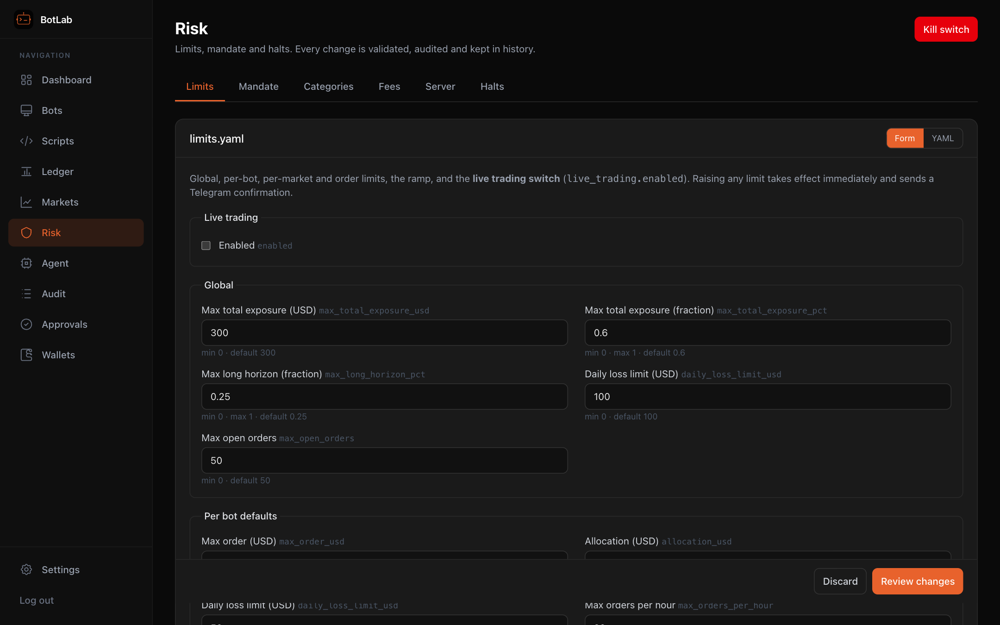
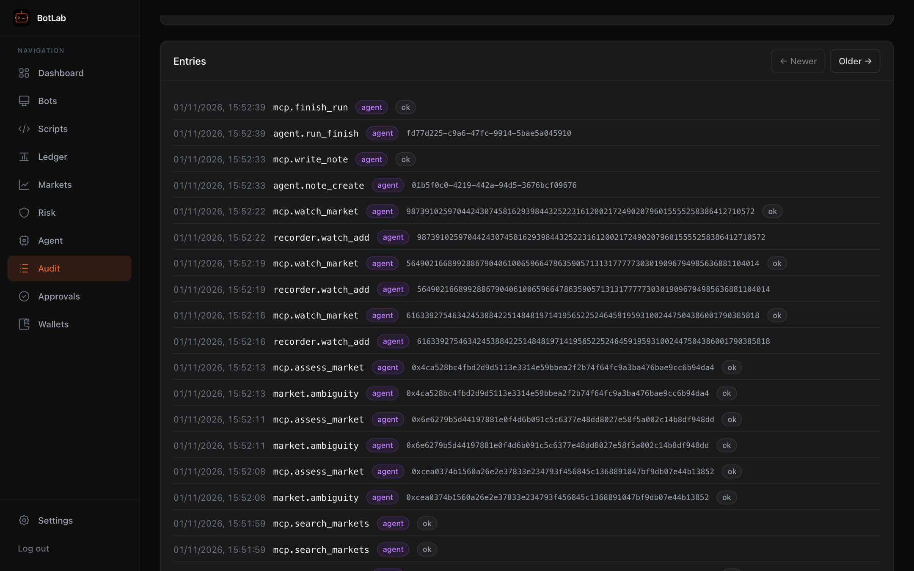
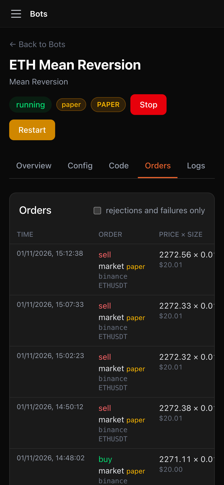

[← BotLab README](../../README.md)

# Operating BotLab

## First run, paper mode and going live

1. Open the UI, set the admin password (with the setup code from the log when not on the server
   itself: `docker compose logs botlab | grep "Setup code"`).
2. Create a bot from a template — new bots are **paper** bots (simulated balance, real market data).
3. Live trading is **off** until you enable it explicitly: add a wallet (Wallets page), set
   `live_trading.enabled: true` (Risk page → Limits, or `limits.yaml`), and create the bot in **Live** mode. Until then live
   bots are refused at start and any live order is rejected (`live_disabled`).
4. All hard limits (exposure, loss limits, order sizes, ramp) are in `config/limits.yaml` and
   `config/mandate.yaml`; edit them on the Risk page (validated, risk raises flagged, history with
   diff and restore) or by hand — edits are picked up without a restart.
5. Before a bot may **buy** a Polymarket market, the market's rules must be assessed: Markets page →
   open the market → **Set ambiguity** (or a forecast with an ambiguity score).

After an unclean stop (crash, power cut, Windows Update reboot, a second Ctrl+C) the server starts with a
**global halt**; open orders are cancelled. Clear it after checking: **Clear halt** on the Dashboard or the
Risk page (a reason and, if your last password check is older than 15 minutes, your password).

## Human-owned limits

Limits, mandate, categories and fees are YAML files with a validated form editor (risk raises are flagged,
every change is kept with a diff and restore). The audit log records what you, the system and the agent do.

| Risk limits | Audit log |
|---|---|
|  |  |

## Dashboard, and your phone

The dashboard has the kill switch, live exposure, daily P&L, reconciliation and every bot at a glance.

The UI works at phone width too, for checking on bots over Tailscale:

## Configuration

| variable | default | |
|---|---|---|
| `BOTLAB_DATA_DIR` | see [Install](install.md#quick-start) | database, backups, logs, master.key |
| `BOTLAB_CONFIG_DIR` | see [Install](install.md#quick-start) | limits / mandate / fees / server / categories `.yaml` |
| `BOTLAB_MASTER_KEY` / `BOTLAB_MASTER_KEY_FILE` | — | [master key](install.md#master-key) |
| `BOTLAB_HOST` | `127.0.0.1` | bind address (`http.host` in server.yaml). Never a public interface; a warning is logged for `0.0.0.0` |
| `BOTLAB_PORT` | `3780` | `http.port` in server.yaml |
| `BOTLAB_ALLOWED_HOSTS` | — | extra UI host names, comma-separated (IPs, `localhost`, `*.ts.net` always allowed) |
| `BOTLAB_LOG_DIR` | `<data dir>/logs` | daily log files |
| `TELEGRAM_BOT_TOKEN` | — | overrides `notify.telegram.bot_token` in server.yaml |
| `ANTHROPIC_API_KEY` | — | the scheduled agent's API key (only from the environment; never stored by BotLab). See [Running the agent](agent.md#running-the-agent) |
| `TZ` | system | e.g. `Europe/Dublin` |

A `.env` file in the working directory is read at start.

**`min_liquidity_usd` is 24 h volume.** Both `limits.yaml per_market.min_liquidity_usd` and `mandate.yaml
markets.min_liquidity_usd` (default 5000; the larger applies) are compared with the market's Gamma **24 h volume**
— by the forecast ledger, the risk engine and copy trading alike — not with order-book liquidity. On the
2026-10-31 Mac test only a handful of in-mandate markets (economics / politics-non-us / weather-climate ending
within 90 days) cleared $5,000 of 24 h volume, so most forecasts and bids in those categories were refused. If you
want BotLab to trade more of them, consider lowering `min_liquidity_usd` (your call; the agent cannot change it).

**A lower floor for forecasts only.** To build the forecast track record in thin categories without loosening live
orders, set `markets.min_forecast_volume_usd` in `mandate.yaml` (Risk → Mandate; at most `min_liquidity_usd`,
e.g. 1000). Forecasts then need only that much 24 h volume; every order still needs `min_liquidity_usd`. Markets
between the two are forecast-only: they are scored and count toward category rights, but the Forecast Executor
does not bid on them. Leave it unset to keep one floor for both.

## Access, API and tokens

- **UI / admin**: password login → session cookie (httpOnly, SameSite=Strict, 7 days idle / 30 days
  max). Human-only actions (clear a halt, config writes/restores, position adoption, market ambiguity,
  forcing category rights, wallets, Binance credentials, settings, creating API tokens) also need the
  password entered within the last 15 minutes; the UI asks for it when needed.
- **Password guessing**: 5 wrong passwords per 15 minutes per client address, then 429. Behind a local
  proxy such as `tailscale serve`, every client arrives from 127.0.0.1, so logins share one bucket
  (someone guessing can lock you out for 15 minutes; re-auth is keyed per session). Use the CLI
  (`set-password`) if you are ever locked out of a fresh setup.
- **HTTP API**: `/api/*`, JSON `{ success, data?, error?, code? }`; mutations need the `X-BotLab: 1`
  header when using the cookie. Events: `GET /api/events` (server-sent events: `bot:event`, `bot:log`,
  `risk:halt`, `risk:halt-cleared`, `config:changed`, `market:rulesChanged`, `agent:run`). Health: `GET /healthz`
  (no auth; 503 when the DB fails, the server is locked, the reconciler is stale > 3 min or a bot
  worker crashed).
- **API tokens** (`Authorization: Bearer blt_…`): scope `agent` (the [MCP agent](agent.md#mcp-server-ai-agent); on `/api` it keeps
  read routes, scripts, backtests, paper bot create / config update of its own bots / start of its own bots /
  stop, forecasts, kill switch — never wallets, credentials, settings, config writes or halt clearing) or
  `readonly` (GET only, and not wallets, settings, config or script export).
  `npm run cli -- token create --scope agent --name mcp` · `token list` · `token revoke <id>`.
- Forgot the admin password: `npm run cli -- set-password` (add `--prod` for the `npm start` data dir).

## Security notes

- Bind to `127.0.0.1` (default) or the Tailscale interface; never expose BotLab to the internet.
- Binance API key: trading only, **withdrawals disabled**, IP allowlist. Polymarket: a dedicated wallet
  funded only with risk capital.
- Bot scripts run in sandboxed worker threads (no filesystem, no environment, bounded heap); they reach
  trading APIs only through the RPC layer, and every order passes the risk engine.
- Secrets are decrypted only inside the server process; the UI only ever sees `hasBinanceCredentials`.
