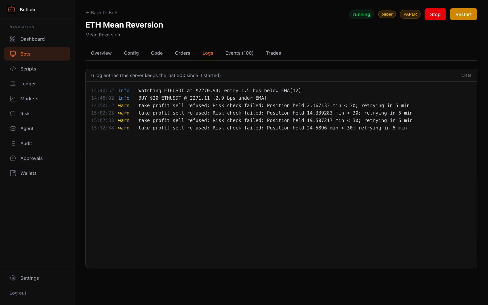
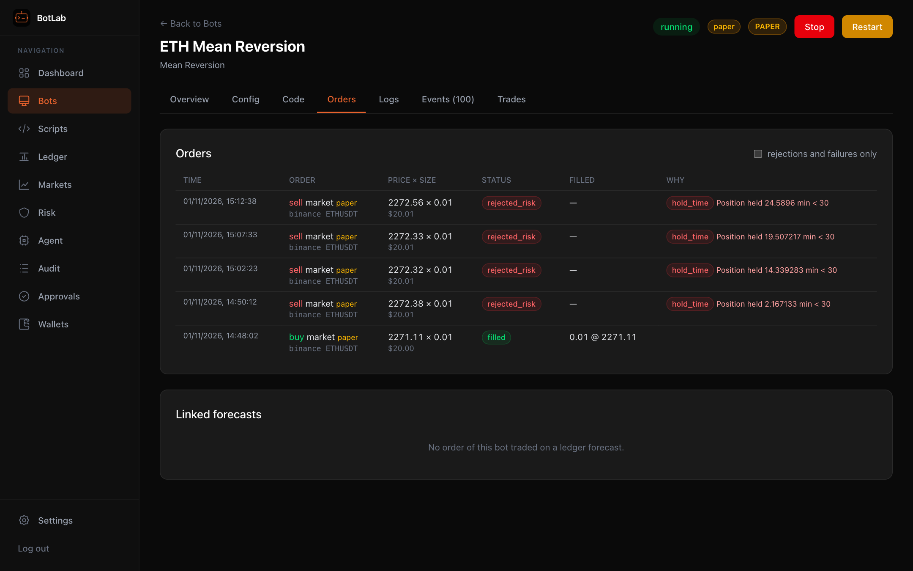
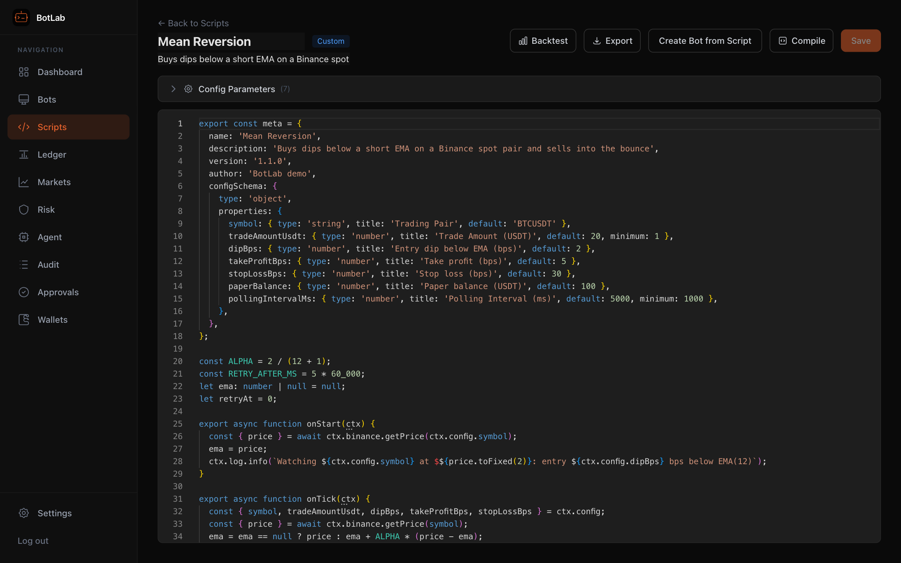
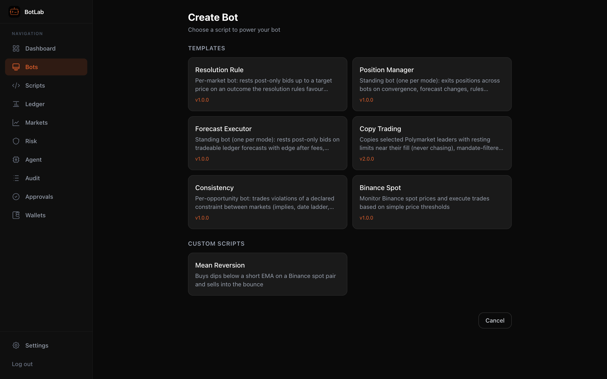

[← BotLab README](../../README.md)

# Bots and scripts

## Bots run your scripts, every order goes through the risk engine

A bot is a script plus a config, running in its own worker thread. Here the **ETH Mean Reversion** bot (a
custom script, shown further down) buys a dip under a short EMA on live Binance prices. The **Logs** tab is the
script's own `ctx.log` output:



**Orders** lists every order the bot attempted, including the ones the risk engine refused. Paper orders go
through the same checks as live ones, so the take-profit sells come back `rejected_risk`: the position is
younger than the 30-minute minimum hold (`limits.yaml` `per_bot_defaults.min_hold_minutes`). The script
backs off and tries again five minutes later.



## Write scripts in the browser, start from templates

Scripts are TypeScript with typings for the whole `ctx` API. `meta.configSchema` becomes the bot's config
form, and **Backtest** replays Binance klines or recorded Polymarket order books. Or start from a built-in template: the Polymarket
forecast executor and position manager, per-opportunity strategies, copy trading, Binance spot.

| Script editor | New bot from a template |
|---|---|
|  |  |

## Writing Bot Scripts

Bot scripts are TypeScript files that export lifecycle functions. The simplest pattern is `onTick` — the framework handles the polling loop for you:

```typescript
export const meta = {
  name: 'My Bot',
  description: 'Does something cool',
  configSchema: {
    type: 'object',
    properties: {
      symbol: { type: 'string', title: 'Trading Pair', default: 'BTCUSDT' },
      amount: { type: 'number', title: 'Trade Amount', default: 10 },
      pollingIntervalMs: { type: 'number', title: 'Polling Interval (ms)', default: 30000 },
    },
  },
};

// Called once on start (optional — use for one-time setup)
export async function onStart(ctx) {
  ctx.log.info('Bot started!');
}

// Called every pollingIntervalMs — put your strategy here
export async function onTick(ctx) {
  const price = await ctx.binance.getPrice(ctx.config.symbol);
  ctx.log.info(`${ctx.config.symbol}: $${price.price}`);
}

export async function onStop(ctx) {
  ctx.log.info('Bot stopped');
}

export function onHeartbeat(ctx) {
  return { status: 'running' };
}
```

### Simple vs Advanced Pattern

- **Simple (`onTick`):** Export `onTick(ctx)` and the framework polls it automatically at `pollingIntervalMs` (default: 10s). Best for most bots.
- **Advanced (`onStart` only):** Set up your own `ctx.setInterval()` loops in `onStart`. Use this for complex bots that need multiple loops running at different intervals (e.g., copy-trading, odds-threshold).

At least one of `onStart` or `onTick` must be exported. Both can coexist — `onStart` runs first, then `onTick` polling begins.

### Script API Reference (`ctx`)

**Polymarket Trading**
| Method | Description |
|--------|-------------|
| `ctx.buy(tokenId, amountUsd, opts?)` | Buy prediction market tokens |
| `ctx.sell(tokenId, amountTokens, opts?)` | Sell prediction market tokens |
| `ctx.getOrderBook(tokenId)` | Get bids/asks for a token |
| `ctx.getPositions()` | Get all open positions |
| `ctx.getBalance()` | Get USDC wallet balance |

**Market Data**
| Method | Description |
|--------|-------------|
| `ctx.getMarkets(query?)` | Search/filter Polymarket markets |
| `ctx.getMarketPrice(tokenId)` | Get bid/ask/mid/spread |
| `ctx.getEvent(eventSlug)` | Get event with all its markets |

**Orders v2, ledger, risk, events** (full types: `botlab://sdk/types.d.ts`)
| Method | Description |
|--------|-------------|
| `ctx.polymarket.placeLimit(tokenId, side, price, size, opts?)` | Post-only GTD limit order (`ttlMinutes` ≥ 3, `forecastId`, `reason`) |
| `ctx.polymarket.cancel / cancelAll / getOpenOrders / getFee` | This bot's orders; fee rates |
| `ctx.ledger.getActiveForecasts(filter?)` / `getForecast(tokenId)` | Read the forecast ledger |
| `ctx.risk.getBudget()` | Remaining allocation, per-market room, halted |
| `ctx.risk.getExitFlags()` | Open exit flags on this bot's positions |
| `ctx.polymarket.getMarket(conditionIdOrTokenId)` | Cached market: tokens, complement (NO) token, end date, closed, ambiguity, rules hash / change, dispute, in this bot's scope |
| `ctx.requestRetire(reason)` | Retire this bot (terminal; the server stops it) when its opportunity is over |
| `ctx.events.on('forecast_changed' \| 'rules_changed' \| 'halt', fn)` | Server push events (hints to re-check) |
| `ctx.portfolio.*` | Position Manager template only |

**Binance Spot**
| Method | Description |
|--------|-------------|
| `ctx.binance.buy(symbol, usdtAmount)` | Market buy (e.g., spend 100 USDT on BTC) |
| `ctx.binance.sell(symbol, quantity)` | Market sell (e.g., sell 0.01 BTC) |
| `ctx.binance.getPrice(symbol)` | Current price |
| `ctx.binance.getBalance(asset?)` | Balance for an asset (default: USDT) |
| `ctx.binance.getOrderBook(symbol)` | Order book depth |
| `ctx.binance.getPositions()` | All non-zero balances |

**Kelly Criterion (Position Sizing)**
| Method | Description |
|--------|-------------|
| `ctx.kelly.calculate(winRate, sampleSize, marketPrice, bankroll, config?)` | Calculate optimal position size using the Kelly Criterion. Returns `{ shouldTrade, tradeAmount, positionFraction, edge, confidence, reason }` |
| `ctx.kelly.DEFAULT_CONFIG` | Default config: quarter Kelly, 3% min edge, 5% max position, 20 min sample size |

`config` is optional and defaults to conservative quarter-Kelly sizing. Override with `{ kellyFraction, minEdge, maxPositionFraction, minSampleSize, confidenceDecayRate }`.

**Utilities**
| Method | Description |
|--------|-------------|
| `ctx.fetch(url, init?)` | HTTP requests to external APIs |
| `ctx.setInterval(fn, ms)` | Repeating timer (auto-cleaned on stop) |
| `ctx.setTimeout(fn, ms)` | One-shot timer (auto-cleaned on stop) |
| `ctx.log.info/warn/error/debug(...)` | Logging (visible in bot detail view) |
| `ctx.storage.get/set/delete(key)` | Persistent key-value storage per bot |
| `ctx.emit(type, data?)` | Emit custom events |
| `ctx.config` | User-configured values from the UI form |
| `ctx.botId` / `ctx.botName` | Bot metadata |
| `ctx.wallet.address` / `ctx.wallet.proxyAddress` | Wallet info (read-only) |

### Config Schema

The `meta.configSchema` object is a JSON Schema that generates the configuration form in the UI when creating a bot. Supported types: `string`, `number`, `integer`, `boolean`, `array`. Each property becomes a form field with the `title` as the label and `description` as help text.

## Built-in Templates

| Template | Description |
|----------|-------------|
| **Forecast Executor** | Standing bot (one per mode): trades the forecast ledger with post-only, Kelly-sized bids. See [Strategies](strategies.md). |
| **Position Manager** | Standing bot (one per mode): exits every bot's positions as risk exits. See [Strategies](strategies.md). |
| **Consistency** | Per opportunity: trades violations of a constraint between markets (implies, date ladder, exclusive sum) with hedged baskets. See [Strategies](strategies.md). |
| **Resolution Rule** | Per market: bids up to a target on the outcome its thesis favours, holds to resolution. See [Strategies](strategies.md). |
| **Copy Trading** | Optional (mandate `strategies.allow: copy`): mirrors selected Polymarket leaders with limits near their fill, in mandate markets only; leaders are scored and dropped when their copies lose. See [Strategies](strategies.md). |
| **Binance Spot** | Monitor Binance spot prices and trade based on price thresholds. |

You can **fork** any template to create your own version, or **import/export** scripts as files.
