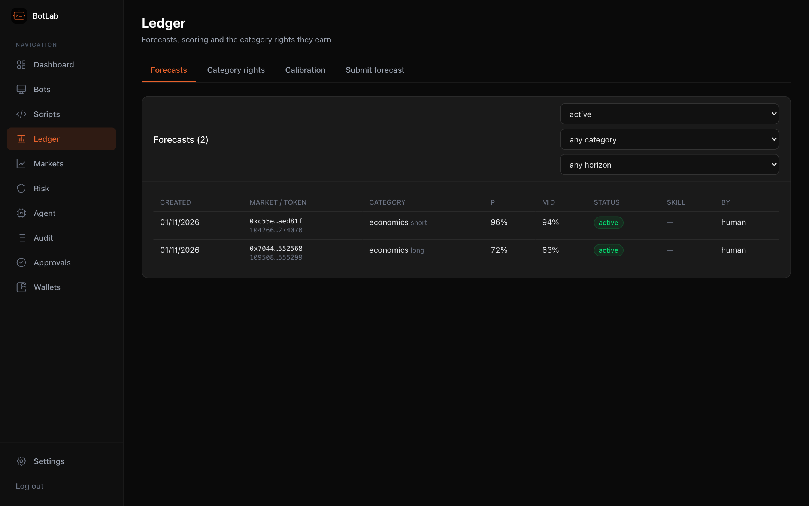

[← BotLab README](../../README.md)

# Strategies

## Markets, forecasts and the ledger

Search live Polymarket markets with their category (from `categories.yaml`), fee rate and ambiguity score.
Forecasts go into the **ledger** (from you or the AI agent) and are scored as their markets resolve. A
category's forecasts become tradeable once it has earned trading rights (or you grant them by hand); the
Forecast Executor bot then rests post-only bids on the ones with enough edge after fees.

| Live Polymarket search | Forecast ledger |
|---|---|
|  |  |

## Forecast Executor and Position Manager

The core strategy is: the agent (or you) writes **forecasts** in the ledger, the **Forecast Executor** buys where
the market is cheaper than the forecast, and the **Position Manager** takes the profit when the price converges
(spec §3.4: edge is usually realised before settlement) or gets out when something changes. Run one bot of each
(Bots → New bot → pick the template; any wallet; a second running copy in the same mode is refused). Both
templates are seeded with trust `new`: their bots start in **paper** and go through the ramp (paper → probation →
full) like any new template. Paper bots fill resting orders when a later book check crosses them (no fees for
makers).

**Forecast Executor** (`templates/forecast-executor.ts`, spec §9.1) — for every *tradeable* active forecast
(bucket `trading`, category allowed) it looks at the forecast's token (fair value p) and the other token of the
binary market (fair value 1 − p). Where the ask leaves `min_edge` after the taker fee it rests a post-only GTD bid
at min(best bid + tick, fair − `min_edge`). Size = `kelly_fraction` × Kelly (p − c)/(1 − c) × the bucket's
allocation, capped by `max_per_market_usd` and `ctx.risk.getBudget()`; when the budget does not cover everything
the best **edge per day** (edge / days to settlement) wins, at most `max_markets` markets. Re-quotes every
`requote_minutes` and immediately on forecast / rules / halt events; cancels its bids when the forecast is
superseded, withdrawn, no longer tradeable or the edge is gone. It never sells.

| config | default | |
|---|---|---|
| `min_edge` | 0.05 | edge after fees, never below 0.03 (the risk engine checks it too) |
| `kelly_fraction` | 0.25 | fraction of full Kelly |
| `requote_minutes` | 10 | how often quotes are recomputed |
| `bid_ttl_minutes` | 60 | resting bids' lifetime (min 3); re-placed only when ≤ min(5 min, ttl / 2) remain or the price / size must change |
| `max_per_market_usd` | 25 | this bot's cost + open bids per market |
| `max_markets` | 10 | |
| `min_edge_per_day` | 0.001 | quotes below this edge / day are skipped; **keep equal to the Position Manager's `min_hold_edge_per_day`** |

It leaves its own resting bids out of the book (it never outbids itself) and keeps a bid while it is still at or
above the best competing bid. It quotes no more markets than `limits.yaml per_bot_defaults.max_orders_per_hour`
can keep quoted (`ctx.risk.getBudget().ordersPerHour`; about 9 markets at 20/h with 60-minute bids) and places at
most the orders left this hour. The hourly rate counts only orders a bot itself submitted (not risk rejections,
not the Position Manager's exits placed for it); 6 risk rejections within 10 minutes pause a bot's own
submissions until the window drains (`rejection_cooldown`). After the Position Manager stops a position out — on
any bot's position in the same mode — the token is skipped until its forecast is renewed, and a token (or its
complement) with an open exit flag on any bot's position is not bid on. Markets whose 24h volume is below the trading
floor (`min_liquidity_usd`) are skipped and its bids there cancelled: forecasts may sit below it when the mandate sets
`min_forecast_volume_usd`, and the risk engine would refuse the bids anyway. Each cycle it records the best edge per day it could not fund (read by the Position Manager).

**Position Manager** (`templates/position-manager.ts`, spec §9.2) — the only bot that can see other bots'
positions (`ctx.portfolio`, granted by the server to this builtin template only; forks do not get it). It exits a
position **as the bot that holds it**: a risk-exit sell through that bot's own order path and the risk engine, so
it can never buy, never sell more than the bot holds net of its open sells, and every exit is in the audit log
(`position.exit`, actor the manager) with the order attributed to the owning bot (`placed_by` the manager).

| trigger | when |
|---|---|
| take-profit (default) | best bid ≥ fair − `take_profit_margin` (0.02); the fair value is per token, so NO positions mirror |
| forecast withdrawn / flipped | no active forecast prices the token, or it values it below the entry price |
| low edge per day | (fair − bid) / days to end < `min_hold_edge_per_day` (0.001; 0 = off) **and** the running executor reported, within the last hour, unfunded demand with a higher edge per day |
| rules changed | the market's rules changed after the position was opened |
| ambiguity | score ≥ 2 (after the server raise) or a UMA dispute |
| exit flag | an open `flag_position_exit` (agent or human); marked handled when the position is closed |
| stop | bid ≤ entry − `stop_loss_move` (0.15) and the forecast was not renewed |
| market end | ambiguity ≥ 1 and less than `exit_before_end_minutes` (180) to the end |

Positions bought without a forecast (copy trading, your own scripts) only get the risk triggers (rules,
ambiguity, flag, end); `ignore_bot_ids` leaves bots alone. Only a human creates, starts or reconfigures these two
bots (the agent may pause them). Scripts cannot flag their own orders as risk exits; the owning bot's own
`cancel` / `cancelAll` leave the manager's exits alone. Exits rest post-only first and become marketable
(best bid − `escalate_slippage`) after `escalate_after_minutes` (30). If the risk engine refuses the marketable
exit (e.g. top of book below `min_top_of_book_usd`), the exit rests post-only one tick above the best bid instead
and marketable is retried after 10 minutes: a triggered position always has an exit order. Risk exits are exempt from hold time, order
size, rate and spread limits and pass from any bot stage (a retired bot's positions can still be exited), but not
from halts: during a halt or kill switch nothing is sold (spec §4.3).

### Per-opportunity strategies: Consistency and Resolution Rule (5b)

These two builtin templates (trust `new`: paper first) are made **one bot per opportunity**, usually by the agent
(it may create, start, reconfigure and retire them; the standing executor / manager stay human-operated). They do
not use forecasts or category rights, but every market they buy must be assessed for ambiguity (R51). A bot's
`market_ids` must cover every token in its config (checked by the server for agent bots; every bot refuses to
start otherwise). When their markets close, or the opportunity is gone, they retire themselves
(`ctx.requestRetire`). Exits on risk triggers (rules change, ambiguity, dispute, exit flags) are left to the
Position Manager. The bot page shows the consistency constraint with its current gap, or the resolution-rule
thesis with its state.

Polymarket has **no shorting**: to "sell" an outcome you do not hold, a bot buys the market's **other (NO) token**
— YES at a plus NO at b pays exactly 1, so the NO token is the short.

**Consistency** (`templates/consistency.ts`, spec §9.3) — a declared logical constraint between binary markets
(their YES tokens, in `tokens`):

| `constraint` | tokens | rule | trade on a violation |
|---|---|---|---|
| `implies` | [A, B] | A implies B: P(A) ≤ P(B) | buy B YES + A NO (pays ≥ 1) |
| `date_ladder` | ordered by deadline, earliest first | "by date 1" implies "by date 2": prices non-decreasing | the most inverted pair: later YES + earlier NO |
| `exclusive_sum` | mutually exclusive outcomes | Σ P ≤ `max_sum` (1) | buy NO on every leg (pays ≥ n − `max_sum`) |
| `exclusive_sum` + `exhaustive: true` | exactly one outcome wins | Σ P = 1 | also: Σ YES < 1 ⇒ buy YES on every leg (pays 1) |

Exhaustiveness is never assumed (an "Other" outcome, a tie or a void breaks it): set `exhaustive` only when the
rules guarantee a single winner. The gap is payoff − Σ (best ask + taker fee at the ask) over the legs, i.e. at
executable prices with the fee on every leg (R125); a basket trades only when the gap ≥ `min_gap` (0.03). One
basket at a time: every leg rests post-only one tick inside its ask, sized by `max_pair_usd` (20), the risk budget
and `max_unhedged_usd` (10: the cost of all legs but the cheapest, i.e. what can fill without its hedge). If some
legs fill and others do not within `hedge_timeout_minutes` (15), the missing legs are bought marketable up to
their ask at opening + `max_slippage` (0.02), and only while the hedged basket still costs no more than it pays.
Otherwise the basket is **unhedged**: no new baskets, and with `flatten_unhedged` (default) the bot sells its own
excess at best bid − `max_slippage` (an ordinary sell: hold time applies, never a risk exit). After
`idle_days` (7) without a gap it retires itself.

**Resolution Rule** (`templates/resolution-rule.ts`, spec §9.4) — one market where the rules favour an outcome.
Config: `token_id`, `target_entry_price`, `max_size_usd`, `thesis` (≤ 2000 chars, shown on the bot page), optional
`forecast_id`, `invalidate_on_rules_change` (true), `max_ambiguity` (1), `invalidate_before_end_minutes` (120),
`requote_minutes` (5). It rests post-only GTD bids one tick over the best other bid, never above the target, until
it holds `max_size_usd` of cost, holds to resolution and **never sells**. It stops buying for good (cancels its
bids) on a rules change since it first started, a UMA dispute, ambiguity above `max_ambiguity`, the linked
forecast withdrawn or below the target, an exit flag on its position, or the end approaching; the Position Manager
handles any exit, and the bot retires itself once flat or when the market closes.

### Copy Trading v2 (5c, optional)

`templates/copy-trading.ts` (spec §9.5) follows a few Polymarket wallets ("leaders", config `leaders`). It is a
builtin strategy template with trust `new` (paper first); the agent may create copy bots only when
`mandate.strategies.allow` contains `copy` (off by default). Upgrading replaced the v1 template in place, so existing
copy bots went back to paper and keep their config (`traders` / `baseMultiplier` / `maxOrderSizeUsd` are still read).
Without `copy` in `strategies.allow` a copy bot (human or agent) buys nothing; it still mirrors leader sells.

| v1 behaviour | v2 |
|---|---|
| sold a USD amount as tokens | sells mirror the leader's sold **fraction** of their position, capped at our holdings net of open sells |
| market (FOK) orders | limit at leader fill + `max_chase` (0.01), GTD `ttl_minutes` (10, ≥ 3); skipped when the best ask is already above it; sells rest at fill − `max_chase` |
| de-dup by timestamp, 20 rows | de-dup by transaction hash + log index (in `ctx.storage`), activity paginated until the last seen trade, `TRADE` rows only, oldest first; the first poll copies no backlog |
| small-trade boost, own daily cap | size = `copy_fraction` (0.1) × leader USD or `fixed_usd`, capped by `max_order_usd` (25) and the risk budget (allocation, market room) |
| no leader filtering | buys skipped below `min_leader_trade_usd` (10), above `max_leader_trades_per_day` (40), or within `mm_window_minutes` (30) of an opposite trade by the leader in the same market (market making) |
| any market | buys only in markets passing the mandate (category, 24h volume ≥ `min_liquidity_usd`, horizon, **assessed** ambiguity; `ctx.risk.getMandateSummary`), no dispute / recent rules change, outside the Position Manager's exit window, no exit flag, not sold by the Position Manager in the last `pm_cooldown_days` (7) |

**Leader scoring** (`copy_leaders`, `copy_trades`): every order a copy bot places carries the leader it copies, so
each fill is attributed. A *copied trade* is a round trip in one token attributed to one leader (opened by a copied
buy, closed when that leader's lot is sold — by copied sells, Position Manager exits or the resolution close); P&L
includes fees. The bot page's **Leaders** panel (and MCP `get_copy_leaders`) shows per leader: status, orders copied,
closed / open trades, hit rate, realised and unrealised P&L (at the market cache's last price) and the auto-drop
window. A leader whose **last 20 closed copied trades** (since it became active) have **net P&L < 0 and a hit rate
under 50 %** is dropped automatically (audited `copy.leader_dropped`, Telegram): the bot no longer copies its buys
(its sells are still mirrored to unwind). Only a human re-activates it (Leaders panel), which starts a new window.
Leader changes in the config apply at the bot's next start. The daily digest lists every leader.
